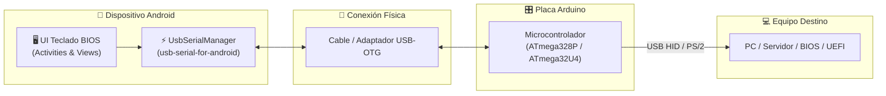

# Teclado BIOS Arduino ⌨️ 🤖

[](https://opensource.org/licenses/Apache-2.0)
[](https://www.android.com/)
[-orange.svg)](https://developer.android.com)
[-brightgreen.svg)](https://developer.android.com)
[](https://www.arduino.cc/)

Una aplicación Android diseñada para convertir tu smartphone o tablet en un teclado físico virtual y consola de control para acceder a la **BIOS / UEFI**, sistemas operativos heredados o terminales embebidas mediante una placa **Arduino** conectada por **USB OTG**.

---

## 📋 Tabla de Contenido
- [Características Principales](#-características-principales)
- [Arquitectura del Sistema](#-arquitectura-del-sistema)
- [Diagrama de Conexión de Hardware](#-diagrama-de-conexión-de-hardware)
- [Estructura del Proyecto](#-estructura-del-proyecto)
- [Requisitos Previos](#-requisitos-previos)
- [Instalación y Configuración del SDK](#-instalación-y-configuración-del-sdk)
- [Compilación y Construcción](#-compilación-y-construcción)
- [Guía de Uso](#-guía-de-uso)
- [Optimización de Disco y Entorno](#-optimización-de-disco-y-entorno)
- [Licencia](#-licencia)

---

## ✨ Características Principales

- **Conexión Directa USB OTG:** Comunicación serie de baja latencia con Arduino mediante la biblioteca `usb-serial-for-android` (compatible con CH340, CP2102, FT232, PL2303 y CDC-ACM nativo).
- **Teclas Dedicadas para BIOS/UEFI:** Botones táctiles específicos para navegación rápida: `DEL`, `F1`-`F12`, `ESC`, `ENTER`, flechas direccionales (`UP`, `DOWN`, `LEFT`, `RIGHT`), `TAB` y atajos de guardado (`F10`).
- **Detección Automática de Dispositivos:** Identificación automática del hardware Arduino al conectar el cable OTG.
- **Configuración de Baud Rate Flexible:** Selección dinámica de velocidad de transmisión (9600, 19200, 38400, 57600, 115200 bps).
- **Consola de Diagnóstico Serie:** Visualización de mensajes de estado y datos bidireccionales en tiempo real.
- **Sin Dependencias de Nube ni Bloatware:** Aplicación 100% offline, ligera y respetuosa con los recursos.

---

## 🏛️ Arquitectura del Sistema



---

## 🔌 Diagrama de Conexión de Hardware

### Opción 1: Arduino Pro Micro / Leonardo (USB HID Nativo)
El microcontrolador **ATmega32U4** emula un teclado USB HID nativo para la PC mientras recibe comandos serie desde el puerto Android (usando Serial o un módulo USB-Serie secundario):

```
+-------------------+                 +----------------------+                 +-----------------+
| Dispositivo Móvil |                 |  Arduino Pro Micro   |                 |    PC / Placa   |
|     (Android)     | == USB-OTG ==>  | (ATmega32U4 USB HID) | == Cable USB => | (Puerto USB PC) |
+-------------------+                 +----------------------+                 +-----------------+
```

### Opción 2: Arduino Uno / Nano con Salida PS/2
Para computadoras antiguas que requieren teclado PS/2 directo en la placa madre:

```
+--------------------+               +------------------+               +------------------+
| Dispositivo Móvil  | == USB OTG => |   Arduino Uno    |               |  Puerto Mini-DIN |
| (App Teclado BIOS) |               |  (ATmega328P)    |               |     PS/2 PC      |
+--------------------+               +------------------+               +------------------+
                                        Pin D3 (Clock)  -------------->    Pin 5 (Clock)
                                        Pin D2 (Data)   -------------->    Pin 1 (Data)
                                        GND             -------------->    Pin 3 (GND)
                                        5V              <--------------    Pin 4 (+5V VCC)
```

> **Nota de Seguridad:** Se recomienda colocar resistencias pull-up de 4.7kΩ entre las líneas Data/Clock y los 5V si no están provistas por la placa madre.

---

## 📁 Estructura del Proyecto

```
Teclado-BIOS-Arduino/
├── .gitignore
├── LICENSE
├── README.md
├── build.gradle               # Build script raíz con redirección a /tmp
├── gradle.properties          # Memoria JVM y variables de entorno
├── local.properties           # Ruta al SDK de Android
├── settings.gradle            # Configuración de repositorios y módulos
├── setup-sdk.sh               # Script de aprovisionamiento automatizado del SDK
├── app/
│   ├── build.gradle           # Configuración del módulo de aplicación
│   ├── proguard-rules.pro     # Reglas de ofuscación y optimización
│   └── src/
│       └── main/
│           ├── AndroidManifest.xml
│           ├── java/com/diamon/tecladobios/
│           └── res/
└── gradle/
    ├── libs.versions.toml     # Catálogo de versiones centralizado
    └── wrapper/
        ├── gradle-wrapper.jar
        └── gradle-wrapper.properties
```

---

## ⚙️ Requisitos Previos

- **Sistema Operativo:** Linux (Ubuntu 20.04+, Debian, etc.), macOS o Windows (WSL2).
- **JDK:** Java Development Kit (OpenJDK 17 o 21 recomendado).
- **Herramientas de Línea de Comandos:** `curl`, `unzip`, `bash`.
- **Dispositivo:** Teléfono o tablet Android con soporte para USB Host / OTG (Android 5.0 Lollipop / API 21 o superior).
- **Hardware Requerido:**
  - Adaptador o cable USB-OTG (Type-C a Type-A hembra o micro-USB a Type-A).
  - Placa Arduino (Uno, Nano, Pro Micro o Leonardo).
  - Cable USB correspondiente para conectar el Arduino.

---

## 🚀 Instalación y Configuración del SDK

El proyecto incluye el script automatizado [`setup-sdk.sh`](setup-sdk.sh) que descarga las herramientas oficiales de línea de comandos de Android, instala la plataforma `android-34` y las `build-tools 34.0.0` sin necesidad de NDK ni CMake pesados, configurando todo en `/tmp/android-sdk`.

Para ejecutarlo:

```bash
chmod +x setup-sdk.sh
./setup-sdk.sh
```

El script se encargará de:
1. Descargar `cmdline-tools` oficial de Google en `/tmp/android-sdk`.
2. Aceptar automáticamente las licencias de Android.
3. Instalar `platform-tools`, `platforms;android-34` y `build-tools;34.0.0`.
4. Generar el archivo `local.properties` con `sdk.dir=/tmp/android-sdk`.

---

## 🔨 Compilación y Construcción

Para compilar la aplicación en modo Debug:

```bash
./gradlew assembleDebug
```

Para ejecutar pruebas unitarias:

```bash
./gradlew test
```

Para limpiar la compilación:

```bash
./gradlew clean
```

El archivo APK resultante se generará en:
`/tmp/teclado-bios/app-build/outputs/apk/debug/app-debug.apk`

---

## 🎮 Guía de Uso

1. **Instalar el APK** en el dispositivo móvil Android.
2. **Cargar el firmware** correspondiente en la placa Arduino (código receptor serial a emulador HID / PS2).
3. **Conectar el Arduino al teléfono** utilizando el adaptador USB OTG.
4. Conceder el **permiso de acceso USB** cuando el sistema Android lo solicite.
5. Iniciar la aplicación **Teclado BIOS Arduino**:
   - Seleccionar el dispositivo detectado en la lista.
   - Elegir la velocidad en baudios (por defecto: `115200` o `9600`).
   - Pulsar **Conectar**.
6. Conectar la salida del Arduino a la PC y encender el equipo:
   - Pulsar `DEL` o `F2` repetidamente desde la app para ingresar a la configuración de la BIOS/UEFI.
   - Navegar con las flechas direccionales táctiles y configurar los parámetros necesarios.

---

## 💾 Optimización de Disco y Entorno

Para evitar el agotamiento de espacio en entornos con almacenamiento limitado (por ejemplo Cloud Shell o contenedores CI/CD), este repositorio aplica redirecciones estratégicas:

- **Build Output:** Redirigido a `/tmp/teclado-bios/root-build` y `/tmp/teclado-bios/app-build`.
- **Gradle User Home:** Centralizado en `/tmp/.gradle`.
- **Android SDK:** Ubicado en `/tmp/android-sdk`.

---

## 📄 Licencia

Este proyecto está bajo la Licencia Apache 2.0. Consulta el archivo [LICENSE](LICENSE) para más detalles.

Copyright (c) 2026 Daniel Diamon.
