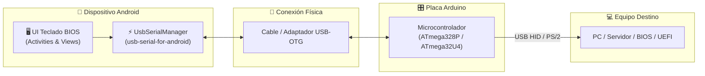

# Teclado BIOS Arduino ⌨️ 🤖

[](https://opensource.org/licenses/Apache-2.0)
[](https://www.android.com/)
[-orange.svg)](https://developer.android.com)
[](https://developer.android.com)
[](https://www.arduino.cc/)

Una aplicación Android diseñada para convertir tu smartphone o tablet en un teclado físico virtual y consola de control para acceder a la **BIOS / UEFI**, sistemas operativos heredados o terminales embebidas mediante una placa **Arduino** conectada por **USB OTG**.

---

## 📋 Tabla de Contenido
- [Características Principales](#-características-principales)
- [Arquitectura del Sistema](#-arquitectura-del-sistema)
- [Diagrama de Conexión de Hardware](#-diagrama-de-conexión-de-hardware)
- [Guía de Diagnóstico Técnico V-USB](DIAGNOSTICO_PROBLEMA_VUSB.md)
- [Estructura del Proyecto](#-estructura-del-proyecto)
- [Requisitos Previos](#-requisitos-previos)
- [Instalación y Configuración del SDK](#-instalación-y-configuración-del-sdk)
- [Compilación y Construcción](#-compilación-y-construcción)
- [Guía de Uso](#-guía-de-uso)
- [Optimización de Disco y Entorno](#-optimización-de-disco-y-entorno)
- [Licencia](#-licencia)

---

## ✨ Características Principales

- **Conexión Directa USB OTG:** Comunicación serie de baja latencia con Arduino mediante la biblioteca `usb-serial-for-android` (compatible con CH340, CP2102, FT232, PL2303 y CDC-ACM nativo).
- **Emulación Compuesta Teclado + Ratón USB HID:** Soporte simultáneo por un único puerto USB de teclado BIOS y ratón para interfaces modernas UEFI y sistemas operativos (Windows, Linux, macOS).
- **Touchpad Táctil Ampliado con Gestos:** Superficie de control táctil de gran tamaño con soporte para:
  - Deslizamiento con 1 dedo para mover el cursor del ratón.
  - Toque con 1 dedo: Clic Izquierdo instantáneo.
  - Toque con 2 dedos: Clic Derecho.
  - Deslizamiento vertical con 2 dedos: Rueda de desplazamiento (Scroll Wheel `#MW:dz`).
- **3 Botones Físicos de Ratón Verificados:** Clic Izquierdo (`L`), Rueda Central (`M`) y Clic Derecho (`R`) con soporte completo de clic simple y arrastre continuo (`#MD:L/R/M` y `#MU:L/R/M`).
- **Teclas Dedicadas para BIOS/UEFI:** Botones táctiles específicos para navegación rápida: `SUPR/DEL`, `F2 SETUP`, `F11 BOOT`, `F12 BOOT`, `F10 GUARDAR`, `ESC`, `ENTER`, `TAB`, `ESPACIO`, `+ (SUBIR)`, `- (BAJAR)`, `F1 AYUDA`, `F9 DEFAULT`, `RE PÁG` y `AV PÁG`.
- **D-Pad de Navegación Direccional:** Cruzeta con flechas `UP`, `DOWN`, `LEFT`, `RIGHT` y botón central `OK/ENTER`.
- **Consola Serie Ampliada con Copiado Fácil:** Altura expandida para visualización clara de logs TX/RX, con botón dedicado de copiado al portapapeles y soporte de **pulsación sostenida** sobre el texto para copiar instantáneamente todo el registro.
- **Sin Dependencias de Nube ni Bloatware:** Aplicación 100% offline, ligera y respetuosa con los recursos.

---

## 🏛️ Arquitectura del Sistema



---

## 🔌 Cómo Construir el Circuito Casero (Hardware DIY)

Para que un **Arduino Uno o Nano** (con microcontrolador ATmega328P a 5V) pueda emular un Teclado y Ratón USB a 3.3V directamente conectado al puerto USB de una computadora, se utiliza la técnica de emulación física **V-USB**. 

Puedes armar este circuito fácilmente en una protoboard o placa perforada utilizando componentes muy económicos y un cable USB reciclado.

---

### 🧰 Lista de Materiales Necesarios

| Componente | Cantidad | Especificaciones / Notas |
|---|:---:|---|
| **Placa Arduino** | 1 | Arduino Uno R3 o Arduino Nano (ATmega328P con chip CH340 o FTDI). |
| **Cable USB "Picado"** | 1 | Cable USB estándar (Tipo-A macho) cortado, pelando sus 4 hilos internos. |
| **Resistencias en serie** | 2 | **45 Ω a 68 Ω** (valores ideales: 68 Ω, 47 Ω o 56 Ω a 1/4W) para las líneas de datos. |
| **Resistencia Pull-up** | 1 | **1.5 kΩ** (1/4W) obligatoria para el estándar USB Low-Speed en D-. |
| **Diodos de limitación** | 2 | **Diodos Zener de 3.6V** (o 3.3V, ej. BZX55C3V6, 1N5227B) o diodos de cristal de alta velocidad (1N4148 / Schottky). |
| **Adaptador USB-OTG** | 1 | Para conectar el puerto USB del Arduino al teléfono móvil Android. |

---

### 🎨 Código de Colores Estándar del Cable USB Picado

Al cortar y pelar el cable USB que irá hacia la PC, encontrarás 4 hilos:

```
[CONECTOR USB TIPO-A (HACIA PC)]
  ├── ROJO   : +5V VBUS  ───────> ⚠️ ¡NO CONECTAR! Cortar y aislar con cinta térmica/aislante.
  ├── BLANCO : D- (Datos -) ────> Conectar a Pin D4 (a través de resistencia de 68Ω) + Pull-up 1.5k a 5V (o D5).
  ├── VERDE  : D+ (Datos +) ────> Conectar a Pin D2 (a través de resistencia de 68Ω).
  └── NEGRO  : GND (Masa)   ────> Conectar al pin GND del Arduino.
```

> [!CAUTION]
> **¡PELIGRO DE CHOQUE ELÉCTRICO CON EL CABLE ROJO (+5V DE LA PC)!**
> El Arduino ya recibe alimentación limpia de 5V desde tu teléfono móvil mediante el cable USB-OTG. **NUNCA conectes el cable rojo (+5V de la PC) al Arduino**. Si los 5V de la PC chocan con los 5V del teléfono, se producirán caídas de tensión, reinicios continuos del microcontrolador o disparos de la protección térmica del puerto OTG del móvil.

---

### 📐 Diagrama Esquemático del Circuito (Alimentado con 5V de Arduino)

```
                         ARDUINO UNO / NANO (ATmega328P)
                        +-------------------------------+
                        |                               |
(Teléfono Android) <==> | Puerto USB-B / Mini-USB (OTG) | (Alimentación 5V + Datos Serie)
                        |                               |
                        |                    Pin 5V     | ────+ (O Pin D5 configurado a 5V)
                        |                               |     |
                        |                               |    [1.5 kΩ] Resistencia Pull-Up
                        |                               |     |
CABLE BLANCO (D-) ──────+───────[ 68 Ω ]──────── Pin D4 | <───+
(USB PC)                |                               |
                       === Diodo Zener 3.6V (Cátodo a D4, Ánodo a GND)
                       GND                              |
                                                        |
CABLE VERDE (D+)  ──────────────[ 68 Ω ]──────── Pin D2 | (Interrupción de hardware INT0)
(USB PC)                |                               |
                       === Diodo Zener 3.6V (Cátodo a D2, Ánodo a GND)
                       GND                              |
                                                        |
CABLE NEGRO (GND) ────────────────────────────── Pin GND|
(USB PC)                                                |
                        +-------------------------------+
```

---

### 🔬 Funcionamiento Eléctrico a 5V con Diodos Zener

El microcontrolador ATmega328P trabaja nativamente a **5V** suministrados por el teléfono vía OTG:
1. **Resistencia Pull-up de 1.5 kΩ conectada a 5V:** La resistencia se conecta directamente al **Pin 5V** del Arduino (o al **Pin D5**, el cual el firmware polariza automáticamente en estado ALTO a 5V mediante software). Esto polariza la línea D- (cable blanco) para que la computadora detecte la presencia de un dispositivo *USB Low-Speed*. **No es necesario usar el pin de 3.3V.**
2. **Limitación de Voltaje con Diodos Zener de 3.6V:**
   * Al colocar un diodo zener de 3.6V entre la línea de datos y GND (con el **cátodo** en la señal y el **ánodo** a masa), la tensión máxima que llega a la PC se recorta de forma segura a exactamente **~3.6V**, protegiendo el chipset de la placa madre y cumpliendo a la perfección los niveles lógicos del bus USB.
3. **Alternativa con Diodos de Cristal de Alta Velocidad (1N4148 / Schottky):**
   * Si no dispones de diodos zener de 3.6V, puedes utilizar diodos rápidos de señal (1N4148) o diodos Schottky conectados en configuración de recorte o en serie para garantizar una caída de tensión adecuada hacia el bus de datos.

---

### 📌 Tabla Resumen de Conexiones Pin a Pin

| Hilo del Cable USB (PC) | Componentes Intermedios | Pin en Arduino Uno / Nano | Propósito |
|---|---|---|---|
| **Verde (D+)** | Resistencia de **45 Ω - 68 Ω** en serie + Zener 3.6V a GND | **Pin D2** | Señal D+ (Dispara la interrupción externa `INT0` de V-USB). |
| **Blanco (D-)** | Resistencia de **45 Ω - 68 Ω** en serie + Zener 3.6V a GND | **Pin D4** | Señal D- (Línea de datos y reinicio eléctrico de bus SE0). |
| **Blanco (D-)** | Resistencia Pull-up de **1.5 kΩ** conectada a **5V** | **Pin 5V** *(o Pin D5)* | **Obligatorio:** Polarización a 5V recortada por Zener a 3.6V (*USB Low-Speed*). |
| **Negro (GND)** | Conexión directa | **Pin GND** | Referencia de masa común obligatoria entre PC y Arduino. |
| **Rojo (+5V)** | **NINGUNO (CORTAR/AISLAR)** | **NO CONECTAR** | Evita cortocircuitos con la alimentación del teléfono móvil. |

---

### 🌟 Firmware v2.0 Unificado (Definitivo): Funciona en BIOS POST y en Sistema Operativo

* **Firmware v2.0 (`arduino_bios_keyboard_v2.hex` / `.ino`) — ¡RECOMENDADO Y DEFINITIVO PARA TODO!**
  * **Arquitectura Dual Boot Interface:** Integra dos interfaces USB estándar simultáneas en un único firmware:
    * **Interfaz 0 (Teclado):** `SubClass = 1 (Boot Interface), Protocol = 1 (Keyboard)` en Endpoint 1 (0x81). Reporte nativo de 8 bytes sin Report IDs.
    * **Interfaz 1 (Ratón):** `SubClass = 1 (Boot Interface), Protocol = 2 (Mouse)` en Endpoint 3 (0x83). Reporte nativo de 4 bytes (3 botones + rueda de scroll).
  * **Comportamiento en la BIOS (Arranque en frío / POST):** La BIOS de cualquier placa madre detecta la Interfaz 0 como un teclado estándar de arranque por hardware. La app muestra inmediatamente **`PC: Conectada`** y puedes pulsar `SUPR/DEL`, `F2`, `F11`, `F12`, `ENTER`, `ESC` y navegar los menús sin problemas.
  * **Comportamiento en el Sistema (Windows, Linux, macOS):** Una vez que el sistema operativo inicia, carga los controladores de ambas interfaces a la vez. El teclado sigue funcionando y el panel táctil (*touchpad*) junto a sus **tres botones virtuales (`CLIC IZQ`, `RUEDA`, `CLIC DER`)** mueven el puntero, hacen clic y hacen scroll de forma nativa.
  * **¡Sin cambiar de firmware!** No necesitas flashear un firmware distinto para cada situación; con la versión 2.0 unificada controlas tanto la BIOS como la PC con sistema.

* **Firmware v1.0 (`arduino_bios_keyboard_v1.hex` / `.ino`):**
  * Versión clásica de solo teclado (Boot Keyboard puro sin interfaz de ratón). Útil como respaldo para placas madre extremadamente antiguas (años 1998-2005) que no admitan descriptores de configuración con más de una interfaz.

---

### 🧪 Test Eléctrico de Pines con la Aplicación

Una vez ensamblado el circuito, antes de conectar la PC puedes comprobar que las resistencias y cables estén perfectos:
1. Conecta el Arduino al teléfono y abre la app **Teclado BIOS Arduino**.
2. Presiona el botón **`#TEST PINES`** (o envía `#TEST` en la consola).
3. El microcontrolador medirá el voltaje de las líneas en reposo y responderá:
   * **`ESTADO ELECTRICO: CORRECTO`** $\to$ Cable blanco en alto (~3.6V por zener) y verde en bajo (0V). ¡Listo para conectar a la PC!
   * **`ERROR: CABLES INVERTIDOS`** $\to$ El cable verde y blanco están al revés (intercambia D2 y D4).
   * **`ERROR: FALTA RESISTENCIA PULL-UP 1.5K`** $\to$ La línea D- está en 0V. Revisa la resistencia de 1.5kΩ hacia el pin 5V (o D5).

> [!TIP]
> Si experimentas reinicios continuos del Arduino al encender la PC o dificultades con menús emergentes en la BIOS, consulta la [Guía Técnica de Diagnóstico V-USB](DIAGNOSTICO_PROBLEMA_VUSB.md) para detalles sobre vectores de interrupción GCC y tiempos de retención.

---

## 📁 Estructura del Proyecto

```
Teclado-BIOS-Arduino/
├── .gitignore
├── LICENSE
├── README.md
├── DIAGNOSTICO_PROBLEMA_VUSB.md # Guía técnica de diagnóstico V-USB e interrupciones
├── arduino_bios_keyboard_v2.ino # Código fuente Arduino del firmware unificado v2
├── arduino_bios_keyboard_v2.hex # Firmware compilado listo para flashear
├── build.gradle               # Build script raíz con redirección a /tmp
├── gradle.properties          # Memoria JVM y variables de entorno
├── local.properties           # Ruta al SDK de Android
├── settings.gradle            # Configuración de repositorios y módulos
├── setup-sdk.sh               # Script de aprovisionamiento automatizado del SDK
├── app/
│   ├── build.gradle           # Configuración del módulo de aplicación (API 23 a 37)
│   ├── proguard-rules.pro     # Reglas de ofuscación y optimización
│   └── src/
│       └── main/
│           ├── AndroidManifest.xml
│           ├── assets/firmware/       # Firmware v2 y guía empaquetados en la app
│           ├── java/com/diamon/tecladobios/
│           └── res/
└── gradle/
    ├── libs.versions.toml     # Catálogo de versiones centralizado
    └── wrapper/
        ├── gradle-wrapper.jar
        └── gradle-wrapper.properties
```

---

## ⚙️ Requisitos Previos

- **Sistema Operativo:** Linux (Ubuntu 20.04+, Debian, etc.), macOS o Windows (WSL2).
- **JDK:** Java Development Kit (OpenJDK 17 o 21 recomendado, compatibilidad bytecode Java 11).
- **Herramientas de Línea de Comandos:** `curl`, `unzip`, `bash`.
- **Dispositivo:** Teléfono o tablet Android con soporte para USB Host / OTG (Android 6.0 Marshmallow / API 23 o superior, compatible hasta Android 17 / API 37).
- **Hardware Requerido:**
  - Adaptador o cable USB-OTG (Type-C a Type-A hembra o micro-USB a Type-A).
  - Placa Arduino (Uno, Nano, Pro Micro o Leonardo).
  - Cable USB correspondiente para conectar el Arduino.

---

## 🚀 Instalación y Configuración del SDK

El proyecto incluye el script automatizado [`setup-sdk.sh`](setup-sdk.sh) que descarga las herramientas oficiales de línea de comandos de Android, instala las plataformas `platforms;android-23`, `platforms;android-37.0` y las `build-tools;37.0.0` sin necesidad de NDK ni herramientas pesadas, configurando todo en `/tmp/android-sdk`.

Para ejecutarlo:

```bash
chmod +x setup-sdk.sh
./setup-sdk.sh
```

El script se encargará de:
1. Descargar `cmdline-tools` oficial de Google en `/tmp/android-sdk`.
2. Aceptar automáticamente las licencias de Android.
3. Instalar `platform-tools`, `platforms;android-23`, `platforms;android-37.0` y `build-tools;37.0.0`.
4. Generar el archivo `local.properties` con `sdk.dir=/tmp/android-sdk`.

---

## 🔨 Compilación y Construcción

Para compilar la aplicación en modo Debug:

```bash
./gradlew assembleDebug
```

Para ejecutar pruebas unitarias:

```bash
./gradlew test
```

Para limpiar la compilación:

```bash
./gradlew clean
```

El archivo APK resultante se generará en:
`/tmp/teclado-bios/app-build/outputs/apk/debug/app-debug.apk`

---

## 🎮 Guía de Uso

1. **Instalar el APK** en el dispositivo móvil Android.
2. **Cargar el firmware** correspondiente en la placa Arduino (código receptor serial a emulador HID / PS2).
3. **Conectar el Arduino al teléfono** utilizando el adaptador USB OTG.
4. Conceder el **permiso de acceso USB** cuando el sistema Android lo solicite.
5. Iniciar la aplicación **Teclado BIOS Arduino**:
   - Seleccionar el dispositivo detectado en la lista.
   - Elegir la velocidad en baudios (por defecto: `115200` o `9600`).
   - Pulsar **Conectar**.
6. Conectar la salida del Arduino a la PC y encender el equipo:
   - Pulsar `DEL` o `F2` repetidamente desde la app para ingresar a la configuración de la BIOS/UEFI.
   - Navegar con las flechas direccionales táctiles y configurar los parámetros necesarios.

---

## 💾 Optimización de Disco y Entorno

Para evitar el agotamiento de espacio en entornos con almacenamiento limitado (por ejemplo Cloud Shell o contenedores CI/CD), este repositorio aplica redirecciones estratégicas:

- **Build Output:** Redirigido a `/tmp/teclado-bios/root-build` y `/tmp/teclado-bios/app-build`.
- **Gradle User Home:** Centralizado en `/tmp/.gradle`.
- **Android SDK:** Ubicado en `/tmp/android-sdk`.

---

## 📄 Licencia

Este proyecto está bajo la Licencia Apache 2.0. Consulta el archivo [LICENSE](LICENSE) para más detalles.

Copyright (c) 2026 Daniel Diamon.
